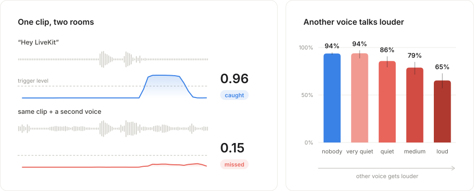
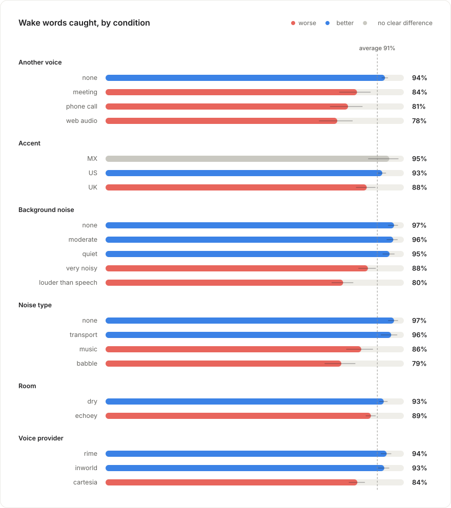
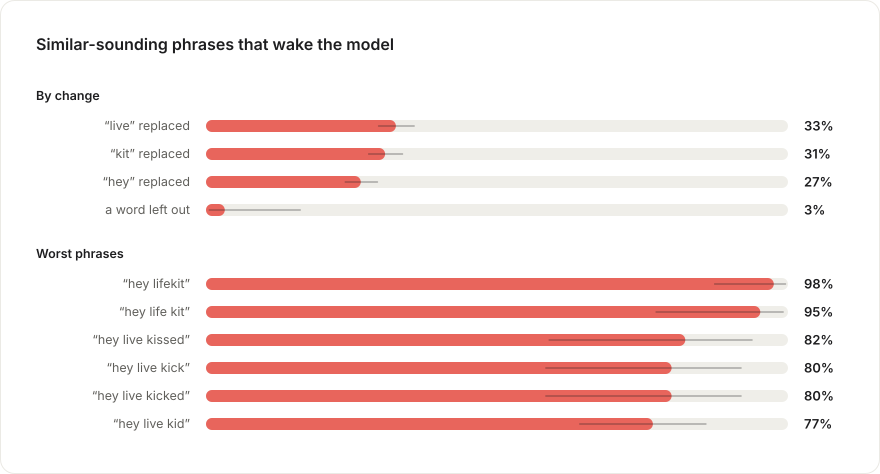

# LiveKit WakeWord Bench

**Find the sounds that fool your wake word.**

[](https://www.python.org/downloads/)
[](LICENSE)
[](https://huggingface.co/datasets/binhpham/wakeword-bench-hey-livekit)

Imagine a developer testing a voice agent at their desk. They say “Hey LiveKit,” and it responds. They try a few more times, and it seems ready. Later, while a colleague is talking nearby, they call it again. This time, nothing happens. They repeat themselves, a little louder.

It's a small failure, but a hard one to debug. Does the model need more examples of their voice? More background noise? A lower detection threshold? Before they can improve it, they need to know what made it stop listening.

We can isolate one of those possibilities by playing the same recording with and without a competing speaker. In the example below, adding a voice quieter than the wake word is enough to turn a detection into a miss.



The clip's score drops from 0.96 to 0.15 with a competing voice 5 dB quieter. Across 3,000 test wake words, recall falls from 94% to 65% as that voice gets louder.

That gives the developer something specific to work on: competing speech. It also gives them a way to check whether more training actually helps.

LiveKit WakeWord Bench makes that process repeatable across noise, speakers, rooms, accents, phrasing and codecs. It reports results for each condition with 95% confidence intervals. Because each generated clip has a known recipe, you can generate training data for a weak spot and benchmark the next model against the same test set. Test voices, noise and rooms stay separate from training.

Use the public “Hey LiveKit” dataset, generate one for your own phrase, or bring your own data and detector.

**Docs:** [Benchmark](docs/benchmark.md) · [Generate](docs/generate.md) · [Train](docs/train.md) · [Reference](docs/reference.md) · [Development](docs/development.md)

## Try it

With Python 3.12+:

```bash
pip install livekit-wakeword-bench

# Point this at your livekit-wakeword model.
lkwb bench path/to/hey_livekit.onnx --limit 1000

# Run the full test set before reporting results.
lkwb bench path/to/hey_livekit.onnx
```

`.onnx` models also need [livekit-wakeword](https://github.com/livekit/livekit-wakeword) v2 (streaming) installed. Any other model plugs in with a few lines of Python ([below](#bring-your-own-model)).

The default dataset has 7,873 clips (12.3 hours). Each run saves JSON summaries, per-clip outcomes and score traces under `results/<model>/`, plus `results/report.html` with playable failures. Benchmarking existing data doesn't need LiveKit credentials. How the score and other numbers are computed: [Benchmark](docs/benchmark.md#read-the-results).

**The score is recall at no more than 0.5 false alarms per hour.** Higher is better. Set a different target with `--score-fpph`. Quick runs use a fixed random subset; compare runs with the same dataset and limit. Use `--workers 1` for accurate compute timing.

## What it finds

The [`hey_livekit`](https://github.com/livekit/livekit-wakeword) model catches 91% of wake words at the default threshold, with 1.3 false alarms per hour. At the benchmark's target of 0.5 false alarms per hour, recall is **89.8%**.

The average hides where it fails. These results use the default threshold:

| Condition | Result | Data to try next |
|---|---|---|
| Loud second speaker | 65% recall, vs 94% alone | More competing talkers |
| Babble noise | 79% recall | More crowd and café noise |
| Noise louder than speech | 80% recall | More examples in loud noise |
| Near-miss phrases | 30% trigger the model; “hey live kid” 77% | More adversarial negatives |



Red is clearly worse than average, green clearly better, gray too close to call. Whiskers show 95% confidence intervals.

<details>
<summary>Near-miss phrases</summary>



Changing one word still triggers the model about a third of the time.

To reproduce with `hey_livekit.onnx` available locally:

```bash
uv run lkwb bench hey_livekit.onnx
uv run --group dev python scripts/readme_figures.py results/hey_livekit --dataset binhpham/wakeword-bench-hey-livekit --model hey_livekit.onnx
```

</details>

**Limits:** Wake words are synthesized, so these results don't establish recall on real users. Negative audio totals only 6.1 hours, which limits estimates of rare false alarms. Accent labels come from TTS provider metadata. Treat small slices and wide confidence intervals cautiously.

## Bring your own model

A detector takes a mono audio clip and returns scores over time. It controls how the audio is streamed internally.

```python
import numpy as np
from livekit_wakeword_bench import Prediction, benchmark

class MyModel:
    name = "my-model"

    def detect(self, audio: np.ndarray, sample_rate: int) -> Prediction:
        times, scores = run_my_model(audio, sample_rate)  # your inference code
        return Prediction(times, scores)

result = benchmark(MyModel(), limit=1000)
print(result.summary()["score"])
result.save("results/my-model")
```

`scores[i]` is emitted after hearing `times[i]` seconds of audio. Detectors that only emit triggers can return `Prediction.from_events([1.9, 7.4])`.

For CLI use, expose a factory that returns your detector:

```bash
uv run lkwb bench my_pkg.models:make_model --json
uv run lkwb compare results/baseline results/candidate --json
```

A `.onnx` path runs a livekit-wakeword model, and `openwakeword:<name>` runs openWakeWord. See [examples/](examples/) for custom detectors and [AGENTS.md](AGENTS.md) for the benchmark → train → compare workflow. More in [Benchmark](docs/benchmark.md).

## Generate training data

Generation uses [LiveKit Inference](https://docs.livekit.io/agents/models/tts/inference/) and spends inference credits. Install the [LiveKit CLI](https://docs.livekit.io/intro/basics/cli/), then connect your project:

```bash
lk cloud auth
lk app env -w

uv run lkwb generate "hey jarvis" --size small -o out/hey_jarvis
```

Choose the plan that matches your account: `--plan build` (default), `ship` or `scale`. Don't raise TTS concurrency above your plan's limit. Synthesized speech is cached, so changing only the augmentation reuses it.

> [!WARNING]
> Generation shares TTS connection capacity with your production voice agents. Using all available connections can prevent those agents from generating speech. Leave capacity for production by setting a lower limit, such as `--set tts.concurrency=2`, based on your plan and expected traffic.

To target competing speakers in training:

```bash
uv run lkwb generate "hey livekit" -o out/train_v2 --split train \
    --set splits.train.augment=true \
    --set augment.p_interferer=0.6 \
    --set augment.clean_weight=0.2
```

The generator combines phoneme-steered speech with real noise, reverb, competing talkers and microphone/codec effects. It creates positives, near-miss phrases, ordinary speech and noise-only clips.

Use `--size tiny` for a smoke test or `small` for a first dataset. For unusual names, `lkwb init "hey jarvis"` creates a pronunciation config; `lkwb pronounce` shows what each TTS provider receives. Check generated audio with `lkwb verify out/hey_jarvis`.

Run `lkwb knobs` for all settings. Pass them as `--set key=value`, Python keyword arguments such as `augment__p_reverb=0.8`, or YAML with `-c`.

More in [Generate](docs/generate.md) and [Reference](docs/reference.md#settings).

## Load data for training

```python
from livekit_wakeword_bench import DEFAULT_DATASET, WakeWordData
from livekit_wakeword_bench.loader import Augment

train = WakeWordData(DEFAULT_DATASET, split="train")  # or a local directory
train = train.with_transform(Augment()).windows(2.0)
x, y = train.take(512).arrays()
torch_dataset = train.torch()  # requires: uv sync --extra torch
```

`Augment()` adds fresh noise, reverb and other effects from training sources on each access. Never train on the test split or test sources. `lkwb export-livekit` writes the LiveKit training layout; `lkwb export-wav` writes WAV files and a CSV. More in [Train](docs/train.md).

<details>
<summary>Audio sources and licensing</summary>

| Split | Noise | Rooms | Real speech |
|---|---|---|---|
| Train / validation | MUSAN, DNS-Noise | MIT RIRs | LibriSpeech |
| Test | DEMAND, WHAM!, ESC-50, GTZAN | OpenSLR 28, Treble10 | AMI, Earnings-22, People's Speech |

WHAM!, ESC-50, Treble10 and GTZAN have non-commercial or research-only restrictions. Use `sources:` in your config to restrict source selection.

Clips contain 16 kHz audio plus metadata for their voice, phrase, timing and augmentation. See [Reference](docs/reference.md#dataset-columns).

</details>

## Documentation

| I want to | Read |
|---|---|
| test a wake word model | [Benchmark](docs/benchmark.md) |
| make data for my own wake word | [Generate](docs/generate.md) |
| train on the data | [Train](docs/train.md) |
| look up a command, setting or column | [Reference](docs/reference.md) |
| work on this repo or cut a release | [Development](docs/development.md) |

## Development

```bash
uv sync --all-extras --group dev
uv run pytest
uv run ruff check src tests
```
