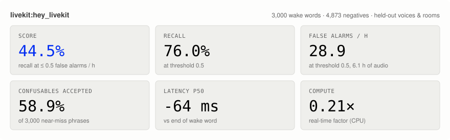
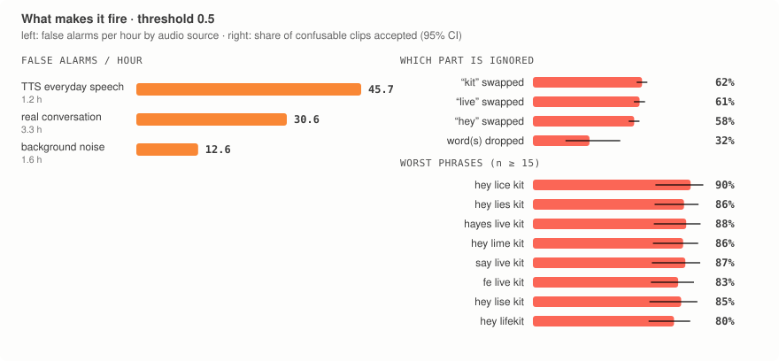

# LiveKit WakeWord Bench

[](https://www.python.org/downloads/)
[](LICENSE)
[](https://huggingface.co/datasets/binhpham/wakeword-bench-hey-livekit)

Generate realistic wake word datasets and benchmark **any** wake word model on them. You get one number to optimize and a breakdown of exactly where the model fails.

**Features:**

- **One score + per-slice diagnostics:** recall at a target false-alarm rate, plus breakdowns by noise level and type, competing talker, reverb, codec, accent, voice and adversarial phrase (with 95% CIs).
- **Precisely pronounced speech:** 157 voices from 4 TTS providers via LiveKit Inference. Wake words and confusables are sent as phonemes, so "LiveKit" is always /ˈlaɪvˌkɪt/.
- **Realistic augmentation:** room reverb, competing talkers, real noise at controlled SNR, mic coloration, band-limiting, clipping and codecs. Test conditions never appear in training data.
- **Model-agnostic:** your model gets the whole clip and returns scores over time. Latency and compute cost are measured too.
- **Agent-friendly:** `--json` everywhere, `lkwb compare` for per-slice deltas, deterministic and cached. See [AGENTS.md](AGENTS.md).

**Quick Links:**

- [Why a benchmark](#why-a-benchmark)
- [Sample results: where `hey_livekit.onnx` fails](#sample-results-hey_livekitonnx)
- [Benchmark a model in 2 commands](#benchmark-a-model)
- [Generate your own dataset](#generate-a-dataset) (LiveKit credentials and plans)
- [Use the data for training](#use-the-data)
- [Bring your own model](#bring-your-own-model)
- [Knobs](#knobs)
- [For agents](#for-agents)
- [How it works](#how-it-works)

## Why a benchmark

The goal is very performant wake word models, built by **agents doing auto-research**: they propose a change, train, measure, keep what helps, and repeat. That only works if the measurement is:

- **fixed and honest:** the same held-out voices, rooms and noise every run, never seen in training
- **one number:** `score` = recall at ≤ 0.5 false positives per hour, the operating point that matters for an always-listening device
- **diagnostic:** *which* conditions fail (competing talker? Opus-compressed audio? UK accents? "hey lice kit"?), so the next experiment is targeted instead of random
- **actionable:** the same generator produces more training data for exactly those conditions
- **cheap and machine-readable:** quick subset runs, cached TTS, JSON output, slice-by-slice `compare`

The [sample results](#sample-results-hey_livekitonnx) below show what that looks like for the current model.

## Sample results: `hey_livekit.onnx`

The current livekit-wakeword model on the full public test split: 7,873 clips (12.3 h), all from voices, rooms and noise it never trained on. To reproduce: `lkwb bench -d livekit:hey_livekit.onnx`, then `lkwb figures results/livekit_hey_livekit`.

<picture>
  <source media="(prefers-color-scheme: dark)" srcset="assets/scorecard_dark.svg">
  
</picture>

**The headline.** At the default threshold (0.5), the model catches 76% of wake words but fires **28.9 times per hour** on ordinary audio. An always-listening device needs ≲ 0.5/h. Reaching that takes threshold 0.94, and recall drops to **44.5%**: the `score`.

<picture>
  <source media="(prefers-color-scheme: dark)" srcset="assets/tradeoff_dark.svg">
  
</picture>

**Where it misses wake words.** A slice is colored only when its 95% CI excludes the overall 76%:

<picture>
  <source media="(prefers-color-scheme: dark)" srcset="assets/failures_dark.svg">
  
</picture>

1. **A competing talker is the biggest failure.** Recall falls from 83% to 38–61%. The louder the other voice, the worse it gets: 67% at 15–20 dB SIR, 30% at 0–5 dB (n ≈ 150 per bin). Even a quiet background talker costs 16 points.
2. **Phrasing:** "Okay, hey LiveKit" gets 63% [59–67], versus 83% [79–86] for "Hey LiveKit, …". The model is weak when the wake word *follows* other speech.
3. **Voices:** UK accents get 59% [55–64] (n = 418), versus 82% for US. By TTS provider, Cartesia voices get 64%, versus 83–84% for xAI and Rime.
4. **Noise:** only the extreme bucket (−5–0 dB SNR, 62%) and speech-like noise (babble 62%, music 62%) hurt significantly. Reverberant rooms get 72%, versus 80% dry.
5. **Not a problem:** codecs (Opus 8–32k, MP3, μ-law: 70–78%, every CI overlaps the overall rate), band-limiting and mic EQ.

**What makes it fire.**

<picture>
  <source media="(prefers-color-scheme: dark)" srcset="assets/false_alarms_dark.svg">
  
</picture>

1. **It accepts near-miss phrases.** 59% of 3,000 confusables trigger it. Swapping *any one* word is accepted about 60% of the time ("kit" 62%, "live" 61%, "hey" 58%). The model matches the overall sound shape rather than checking each word. Worst phrases: "hey lice kit" 90%, "hayes live kit" 88%, "hey lies kit" 86%.
2. **Speech causes the false alarms, not noise.** At threshold 0.5: everyday TTS speech 45.7/h, real conversation 30.6/h, background noise only 12.6/h.

**Caveats.** The wake words are synthetic TTS (phoneme-steered, 157 voices), not human recordings, so absolute recall on real users may differ. Slice comparisons are the reliable part. FPPH comes from 6.1 h of negatives: zero false alarms at threshold 0.94 means the true rate is ≤ 0.49/h with 95% confidence, but the data can't tell 0.5/h apart from 0.1/h. Latency p50 is −64 ms, meaning the model usually fires just before the word finishes.

## Benchmark a model

```bash
uv sync --extra livekit
uv run lkwb bench -d livekit:path/to/hey_livekit.onnx --limit 500   # quick run on a random subset
uv run lkwb bench -d livekit:path/to/hey_livekit.onnx               # full test split (~12 h audio)
```

This uses the public [hey livekit dataset](https://huggingface.co/datasets/binhpham/wakeword-bench-hey-livekit) and needs no credentials. Results go to `results/` along with `report.html`, which has per-slice tables and playable failure clips. Pass `-d` several times to compare models side by side, or point it at your own dataset: `lkwb bench out/my_dataset -d ...`.

## Generate a dataset

### 1. Get LiveKit credentials with the CLI

Speech comes from [LiveKit Inference](https://docs.livekit.io/agents/models/tts/inference/), which needs a LiveKit Cloud project. The free Build plan works, it's just slower.

```bash
brew install livekit-cli                      # macOS
curl -sSL https://get.livekit.io/cli | bash   # Linux
winget install LiveKit.LiveKitCLI             # Windows

lk cloud auth      # log in and link your project (once)
lk app env -w      # writes .env.local (LIVEKIT_URL / LIVEKIT_API_KEY / LIVEKIT_API_SECRET) from .env.example
```

If you have several projects, `lk project list` shows them and `lk project set-default <name>` picks one before `lk app env -w`.

### 2. Set your plan

LiveKit Inference caps concurrent TTS connections per plan ([pricing](https://livekit.com/pricing)), and generation stays under that cap. Your plan is shown in the LiveKit Cloud dashboard.

| plan | `--plan` | concurrent TTS | ~speed |
|---|---|---|---|
| Build (free) | `build` (default) | 5 | ~4 utterances/s |
| Ship | `ship` | 20 | ~15/s |
| Scale | `scale` | 50 | ~30/s |
| Enterprise | `--set tts.concurrency=N` | your limit | |

### 3. Generate

```bash
uv run lkwb generate "hey jarvis" --size small --plan ship -o out/hey_jarvis
```

`--size` sets how many clips each split gets:

| size | train | validation | test |
|---|---|---|---|
| `tiny` | 90 | — | ~250 |
| `small` | 2.3k | ~280 | ~1.3k |
| `default` | 23k | ~2.5k | ~7.9k |

For a reusable config, run `lkwb init "hey jarvis" --plan ship`, edit `hey_jarvis.yaml`, then `lkwb generate -c hey_jarvis.yaml -o out/hey_jarvis`.

- **Unknown words** (brand names) need a pronunciation. `lkwb init` guesses it from sub-words, and `lkwb pronounce "hey livekit" -c cfg.yaml` shows exactly what each TTS will receive.
- **Re-runs are cheap:** TTS results are cached, so re-running with different augmentation knobs costs nothing.
- **Sharing:** `lkwb push out/hey_jarvis you/wakeword-bench-hey-jarvis` uploads the dataset so others can benchmark against it without regenerating.
- **Checks:** `lkwb verify out/hey_jarvis` measures the audio against its labels (SNR, levels, timing, train/test leakage).

## Use the data

```python
from livekit_wakeword_bench import DEFAULT_DATASET, WakeWordData
from livekit_wakeword_bench.loader import Augment

test = WakeWordData(DEFAULT_DATASET, split="test")            # or a local dir
hard = test.filter(category="positive", noise_bucket=["very_noisy", "extreme"])
df = test.metadata()                                           # pandas, no audio decoding

train = WakeWordData(DEFAULT_DATASET, split="train").with_transform(Augment()).windows(2.0)
x, y = train.take(512).arrays()                                # numpy
torch_ds = train.torch()                                       # DataLoader(..., collate_fn=WakeWordData.collate)
```

`Augment()` adds fresh noise, reverb, talkers, EQ and codecs on every access, using only training sources. For livekit-wakeword, `lkwb export-livekit out/hey_jarvis <output_dir> --model-name hey_jarvis` writes its training layout. `lkwb export-wav` writes plain WAV files plus a CSV.

## Bring your own model

```python
import numpy as np
from livekit_wakeword_bench import Prediction, benchmark

class MyModel:
    name = "my-model"
    def detect(self, audio: np.ndarray, sample_rate: int) -> Prediction:
        times, scores = run_my_model(audio, sample_rate)   # stream it however you like
        return Prediction(times, scores)                   # scores[i] emitted after times[i] s of audio

res = benchmark(MyModel(), limit=500)
print(res.summary()["score"], res.breakdown()["positive/noise_bucket"])
```

Models that only emit triggers can return `Prediction.from_events([1.9, 7.4])`. On the CLI, pass `-d my_pkg.module:factory?key=value`. Built-in adapters: `livekit:<model.onnx>`, `openwakeword:<name>`. See [examples/](examples/).

## Knobs

Every config key can be set with `--set key=value` (CLI), `generate(..., key__sub=value)` (Python), or YAML (`-c`). Run `lkwb knobs` to list them all.

```bash
lkwb generate "hey jarvis" -o out/x --set augment.p_interferer=0.5 --set splits.test.n_positive=5000
```

```python
from livekit_wakeword_bench import generate
generate("hey jarvis", "out/x", size="small", plan="ship", augment__p_codec=0.5)
```

| knob | default | meaning |
|---|---|---|
| `splits.<split>.n_positive` / `n_adversarial` / `n_speech` / `n_noise` | per `--size` | clips per category |
| `splits.<split>.real_speech_minutes` | per `--size` | real conversation audio (false-alarm denominator) |
| `splits.<split>.augment` | train: `false` | store augmented audio |
| `augment.snr_buckets` | quiet 20–30 … extreme −5–0 dB | noise levels |
| `augment.clean_weight` / `snr_weights` | 1.0 | how often each level is picked |
| `augment.p_reverb` / `p_interferer` / `p_second_noise` | 0.5 / 0.2 / 0.2 | room, competing talker, layered noise |
| `augment.p_eq` / `p_bandlimit` / `p_clip` / `p_codec` | 0.4 / 0.15 / 0.05 / 0.25 | device and transmission effects |
| `tts.plan` / `tts.concurrency` | build | LiveKit concurrency |
| `tts.models` | all 4 providers | restrict providers |
| `tts.test_voice_fraction` | 0.3 | voices held out for test |
| `pronunciations` / `hard_negatives` / `p_carrier` | | phrasing |

## For agents

Run `lkwb bench --json` for a machine-readable result with `score` and the worst slices. Run `lkwb compare base/ new/ --json` to see what improved or regressed, slice by slice. The full loop is in **[AGENTS.md](AGENTS.md)**.

## How it works

<details>
<summary><b>Dataset categories and columns</b></summary>

| category | label | what |
|---|---|---|
| `positive` | 1 | wake word, alone or in a sentence ("Hey LiveKit, set a timer…", "Okay, hey LiveKit.") |
| `adversarial` | 0 | phonetic neighbours from CMUdict ("hey live kid", "hey lime kit", "hey kit"), weighted toward the closest |
| `speech` | 0 | everyday TTS sentences |
| `real_speech` | 0 | real meetings, calls and web speech (the main false-alarm denominator) |
| `noise` | 0 | background noise only |

Every row has `audio` (16 kHz FLAC) and metadata, including `noise_bucket`, `snr_db`, `noise_type`, `reverb`, `interferer`, `codec`, `augmentations`, `provider`, `voice_name`, `accent`, `held_out_voice`, `text`, `phrase`, `phonemes`, `tts_input`, and `phrase_onset_s` / `phrase_offset_s` (exact wake word timing, used for latency). The full list is `SCHEMA` in [`dataset.py`](src/livekit_wakeword_bench/dataset.py).
</details>

<details>
<summary><b>Phoneme steering</b></summary>

Only TTS models that accept inline phonemes are used. Each was checked by synthesizing phoneme-only words and transcribing the result.

| provider | sent as | voices |
|---|---|---|
| Cartesia `sonic-3` | `<<ˈ\|l\|aɪ\|v\|ˌ\|k\|ɪ\|t>>` | 43 |
| Inworld `inworld-tts-2` | `/ˈlaɪvˌkɪt/` | 26 |
| xAI `tts-1` | `/ˈlaɪvˌkɪt/` | 26 |
| Rime `mistv3` | `{l1Yv} {k1It}` | 62 |

Phonemes come from CMUdict plus `pronunciations` overrides (ARPAbet, `|` between morphemes). Deepgram, Fish Audio and Rime Coda don't accept phonemes, so they're excluded.
</details>

<details>
<summary><b>Augmentation chain</b></summary>

Steps run in physical order: room reverb → competing talker → noise at an SNR bucket (+ optional second noise) → mic EQ → band-limit → input gain → clipping → codec (Opus 8/16/32k, MP3, 8 kHz μ-law). Each step that fires is recorded in the metadata. Noise is sampled by coarse type first (babble, music, street, transport, domestic, office, nature, …), so large corpora don't dominate. The same chain powers `Augment()` for training.
</details>

<details>
<summary><b>Audio sources (train and test are disjoint)</b></summary>

| pool | noise | rooms | real speech |
|---|---|---|---|
| train / val | MUSAN, DNS-Noise (AudioSet) | MIT RIRs | LibriSpeech |
| test | DEMAND, WHAM!, ESC-50, GTZAN | OpenSLR 28 (real + sim), Treble10 | AMI meetings, Earnings-22, People's Speech |

Everything is downloaded from the Hugging Face Hub on first use (`lkwb sources` prefetches it). WHAM!, ESC-50, Treble10 and GTZAN are non-commercial or research-only. Use `sources:` in the config to restrict them.
</details>

<details>
<summary><b>Metrics</b></summary>

| metric | definition |
|---|---|
| `score` | recall at the lowest threshold with FPPH ≤ 0.5 (`--score-fpph`) |
| recall | positives triggered between wake word onset and offset + 1 s |
| FPPH | false triggers per hour of real speech, speech and noise (2 s debounce) |
| adversarial false-accept | share of confusable clips that trigger |
| latency | first trigger − end of wake word (p50 / p90 ms) |
| RTF | `detect()` time ÷ audio duration (use `--workers 1`) |
</details>

## Development

```bash
uv sync --all-extras --group dev
uv run pytest
uv run --group dev python scripts/qa_dataset.py out/hey_jarvis --plots out/qa   # verify + Whisper spot-check + spectrograms
```

The library is pure Python (numpy, scipy, soundfile) with no platform-specific code. Whisper and matplotlib live only in the `dev` group.
