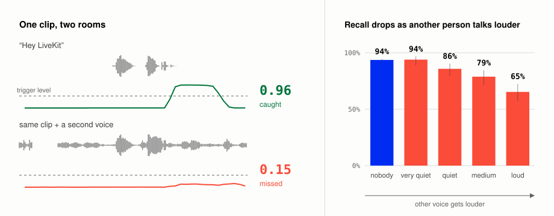
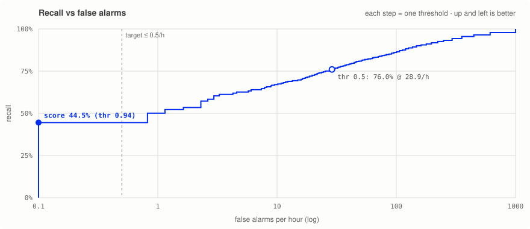
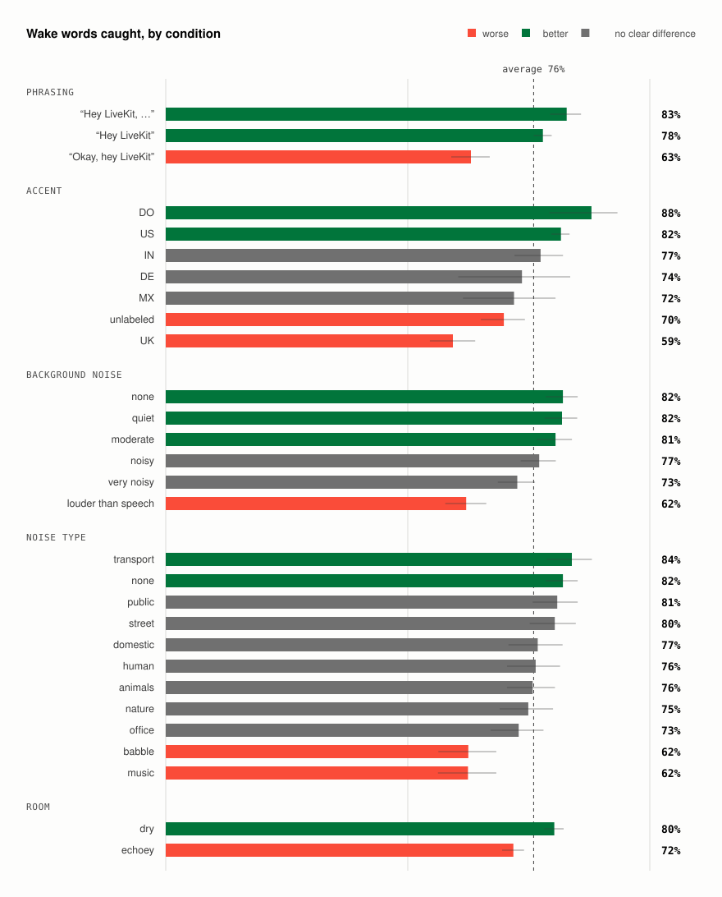
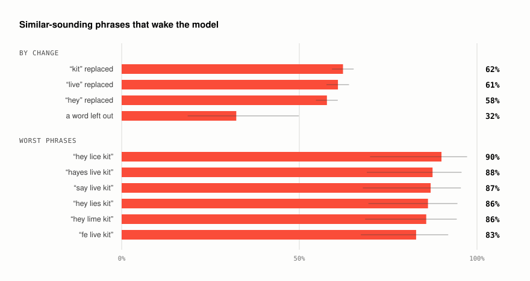
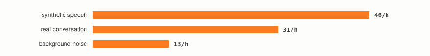

# LiveKit WakeWord Bench

**Find the sounds that fool your wake word.**

Test your model, see where it fails, and generate training data for those conditions.

[](https://www.python.org/downloads/)
[](LICENSE)
[](https://huggingface.co/datasets/binhpham/wakeword-bench-hey-livekit)

<picture>
  <source media="(prefers-color-scheme: dark)" srcset="assets/teaser_dark.svg">
  
</picture>

*Same wake word, different room.* One clip scores 0.97 alone and 0.01 with a second speaker just 5 dB quieter. Across 3,000 test wake words, recall falls from 83% to 30% as the competing voice gets louder.

An overall score won't tell you what to fix. This benchmark breaks results down by noise, competing speakers, room, accent, phrasing and codec, with 95% confidence intervals. Each generated clip has a known recipe, so you can make more training examples of the conditions your model struggles with. Test voices, noise and rooms stay separate from training.

Use the public “Hey LiveKit” dataset, generate one for your own phrase, or bring your own data and detector.

## Try it

From a checkout of this repo, with Python 3.12+ and [uv](https://docs.astral.sh/uv/):

```bash
uv sync --extra livekit

# Point this at your LiveKit wake word ONNX model.
uv run lkwb bench -d livekit:path/to/model.onnx --limit 1000

# Run the full test set before reporting results.
uv run lkwb bench -d livekit:path/to/model.onnx
```

The default dataset has 7,873 clips (12.3 hours). Each run saves JSON summaries, per-clip outcomes and score traces under `results/<model>/`, plus `results/report.html` with playable failures. Benchmarking existing data doesn't need LiveKit credentials.

**The score is recall at no more than 0.5 false alarms per hour.** Higher is better. Set a different target with `--score-fpph`. Quick runs use a fixed random subset; compare runs with the same dataset and limit. Use `--workers 1` for accurate compute timing.

## What it finds

On the `hey_livekit` model, recall is 76% at the default threshold, but false alarms occur about 29 times per hour. At the benchmark's false-alarm target, recall is **44.5%**.

<picture>
  <source media="(prefers-color-scheme: dark)" srcset="assets/tradeoff_dark.svg">
  
</picture>

The breakdown points to specific training needs. These results use the default threshold:

| Condition | Result | Data to try next |
|---|---|---|
| Loud second speaker | 30% recall | More competing talkers |
| Wake word after other speech | 63% recall, vs 83% when first | More wake words inside sentences |
| Near-miss phrases | 59% trigger the model | More adversarial negatives |
| Noise at −5 to 0 dB SNR | 62% recall | More examples in loud noise |

<details>
<summary>More result plots</summary>

<picture>
  <source media="(prefers-color-scheme: dark)" srcset="assets/failures_dark.svg">
  
</picture>

Phrasing, accent, noise and reverb affect recall. Whiskers show 95% confidence intervals.

<picture>
  <source media="(prefers-color-scheme: dark)" srcset="assets/near_misses_dark.svg">
  
</picture>

Changing one word often still triggers the model.

<picture>
  <source media="(prefers-color-scheme: dark)" srcset="assets/alarm_sources_dark.svg">
  
</picture>

Speech accounts for most false alarms in this evaluation.

To reproduce with `hey_livekit.onnx` available locally:

```bash
uv run lkwb bench -d livekit:hey_livekit.onnx
uv run --group dev --extra livekit python scripts/readme_figures.py results/livekit_hey_livekit --dataset binhpham/wakeword-bench-hey-livekit --model hey_livekit.onnx
```

</details>

**Limits:** Wake words are synthesized, so these results don't establish recall on real users. Negative audio totals only 6.1 hours, which limits estimates of rare false alarms. Accent labels come from TTS provider metadata. Treat small slices and wide confidence intervals cautiously.

## Bring your own model

A detector takes a mono audio clip and returns scores over time. It controls how the audio is streamed internally.

```python
import numpy as np
from livekit_wakeword_bench import Prediction, benchmark

class MyModel:
    name = "my-model"

    def detect(self, audio: np.ndarray, sample_rate: int) -> Prediction:
        times, scores = run_my_model(audio, sample_rate)  # your inference code
        return Prediction(times, scores)

result = benchmark(MyModel(), limit=1000)
print(result.summary()["score"])
result.save("results/my-model")
```

`scores[i]` is emitted after hearing `times[i]` seconds of audio. Detectors that only emit triggers can return `Prediction.from_events([1.9, 7.4])`.

For CLI use, expose a factory that returns your detector:

```bash
uv run lkwb bench -d my_pkg.models:make_model --json
uv run lkwb compare results/baseline results/candidate --json
```

Built-in adapters support `livekit:<model.onnx>` and `openwakeword:<name>`. See [examples/](examples/) for custom detectors and [AGENTS.md](AGENTS.md) for the benchmark → train → compare workflow.

## Generate training data

Generation uses [LiveKit Inference](https://docs.livekit.io/agents/models/tts/inference/) and spends inference credits. Install the [LiveKit CLI](https://docs.livekit.io/intro/basics/cli/), then connect your project:

```bash
lk cloud auth
lk app env -w

uv run lkwb generate "hey jarvis" --size small -o out/hey_jarvis
```

Choose the plan that matches your account: `--plan build` (default), `ship` or `scale`. Don't raise TTS concurrency above your plan's limit. Synthesized speech is cached, so changing only the augmentation reuses it.

To target competing speakers in training:

```bash
uv run lkwb generate "hey livekit" -o out/train_v2 --split train \
    --set splits.train.augment=true \
    --set augment.p_interferer=0.6 \
    --set augment.clean_weight=0.2
```

The generator combines phoneme-steered speech with real noise, reverb, competing talkers and microphone/codec effects. It creates positives, near-miss phrases, ordinary speech and noise-only clips.

Use `--size tiny` for a smoke test or `small` for a first dataset. For unusual names, `lkwb init "hey jarvis"` creates a pronunciation config; `lkwb pronounce` shows what each TTS provider receives. Check generated audio with `lkwb verify out/hey_jarvis`.

Run `lkwb knobs` for all settings. Pass them as `--set key=value`, Python keyword arguments such as `augment__p_reverb=0.8`, or YAML with `-c`.

## Load data for training

```python
from livekit_wakeword_bench import DEFAULT_DATASET, WakeWordData
from livekit_wakeword_bench.loader import Augment

train = WakeWordData(DEFAULT_DATASET, split="train")  # or a local directory
train = train.with_transform(Augment()).windows(2.0)
x, y = train.take(512).arrays()
torch_dataset = train.torch()  # requires: uv sync --extra torch
```

`Augment()` adds fresh noise, reverb and other effects from training sources on each access. Never train on the test split or test sources. `lkwb export-livekit` writes the LiveKit training layout; `lkwb export-wav` writes WAV files and a CSV.

<details>
<summary>Audio sources and licensing</summary>

| Split | Noise | Rooms | Real speech |
|---|---|---|---|
| Train / validation | MUSAN, DNS-Noise | MIT RIRs | LibriSpeech |
| Test | DEMAND, WHAM!, ESC-50, GTZAN | OpenSLR 28, Treble10 | AMI, Earnings-22, People's Speech |

WHAM!, ESC-50, Treble10 and GTZAN have non-commercial or research-only restrictions. Use `sources:` in your config to restrict source selection.

Clips contain 16 kHz audio plus metadata for their voice, phrase, timing and augmentation. See the [dataset schema](src/livekit_wakeword_bench/dataset.py).

</details>

## Development

```bash
uv sync --all-extras --group dev
uv run pytest
uv run ruff check src tests
```
